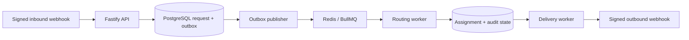

# PulseRoute

[](https://github.com/DavidCampolongo/pulseroute/actions/workflows/ci.yml)

A TypeScript service that accepts signed service-request webhooks, assigns work to eligible operators, and delivers assignment notifications. PostgreSQL records the durable state; Redis and BullMQ coordinate background work.

The backend handles the parts that make asynchronous processing difficult: duplicate requests, concurrent assignments, a queue outage, worker interruption, and failed outbound webhooks. The repository includes integration tests for those failure paths.

**Stack:** TypeScript · Node.js · Fastify · PostgreSQL · Prisma · Redis · BullMQ · Vitest · Docker Compose

## Request flow



## Engineering decisions

| Problem                                                                | Implementation                                                                                                  |
| ---------------------------------------------------------------------- | --------------------------------------------------------------------------------------------------------------- |
| Verify the sender without altering the signed payload                  | HMAC-SHA256 over the timestamp and raw request body; reject expired signatures before business validation.      |
| Accept a request even when queue publication cannot finish immediately | Write the request and outbox event in one PostgreSQL transaction; publish background work from the outbox.      |
| Handle redelivery                                                      | An existing organization/external-request ID returns a duplicate response rather than creating another request. |
| Avoid conflicting assignments                                          | Lock request/operator state and check capacity within the routing transaction.                                  |
| Recover from delivery failures                                         | Track delivery attempts, use bounded retry/backoff, and retain exhausted work for investigation.                |
| Explain what happened                                                  | Persist audit state and emit structured logs.                                                                   |

These are implemented and tested behaviors, not claims of production scale or exactly-once delivery across systems.

## Local setup

Use the toolchain pinned in [package.json](package.json): **Node.js 24.18.0** and **pnpm 11.24.0**. Docker Compose supplies PostgreSQL and Redis.

```sh
git clone https://github.com/DavidCampolongo/pulseroute.git
cd pulseroute
cp .env.example .env
```

Edit `.env` before starting:

- Set `POSTGRES_PASSWORD` and use the same password in `DATABASE_URL`.
- Set distinct `WEBHOOK_SECRET` and `OUTBOUND_WEBHOOK_SECRET` values, each at least 32 characters.
- Set `SEED_USER_PASSWORD` to a local development password of at least 12 characters.
- If ports 5432 or 6379 are occupied, change the corresponding port and connection settings together.

Do not commit `.env` or use real customer data in the demo.

```sh
pnpm install --frozen-lockfile
docker compose --env-file .env -f infra/docker-compose.yml up -d --wait
pnpm db:generate
pnpm db:migrate:deploy
pnpm db:seed
pnpm build
```

Start each service in a separate terminal from the repository root:

```sh
pnpm --filter @pulseroute/fake-receiver dev
pnpm --filter @pulseroute/worker dev
pnpm --filter @pulseroute/api dev
```

The API exposes its documentation at [localhost:3000/docs](http://localhost:3000/docs). The local fake receiver accepts signed deliveries on port 3100 and can simulate failed or delayed responses. See [its configuration](tools/fake-receiver/src/config.ts) for supported modes.

Run the signed-request demo in a fourth terminal:

```sh
pnpm demo
```

```text
First delivery: HTTP 202, accepted
Repeated delivery: HTTP 200, duplicate
Invalid signature: HTTP 401, rejected
```

The script asserts these responses and prints the synthetic request's external ID. The worker and fake-receiver logs show the subsequent assignment delivery. Each invocation creates one new request; repeated demos consume the seeded operators' capacity, so use a fresh local demo database when you need to restart the scenario.

The inbound endpoint is `POST /webhooks/service-requests`. Its [contract](apps/api/src/webhooks/contract.ts) defines organization, event, external request, skill, priority, and region fields. [The webhook integration tests](apps/api/test/webhook-contract.test.ts) show signed requests and expected acceptance, duplicate, and invalid-payload responses.

Stop local dependencies when finished; their named volumes retain data:

```sh
docker compose --env-file .env -f infra/docker-compose.yml down
```

## Verification

Use a **separate test database** with migrations applied. Integration tests create and clean up their own fixtures; never point them at a database containing important data. Match the environment setup in [CI](.github/workflows/ci.yml).

```sh
pnpm db:validate
pnpm format:check
pnpm lint
pnpm typecheck
pnpm build
pnpm test
```

The CI workflow provisions PostgreSQL and Redis and runs these checks for pushes and pull requests. The verified backend release has **240 passing tests in 46 files**: 59 API tests, 108 worker tests, 42 scoring tests, and 31 fake-receiver tests. Counts describe this release, not a performance benchmark.

Representative tests:

- [Signed input and contract validation](apps/api/test/webhook-contract.test.ts)
- [Concurrent operator capacity](apps/worker/test/routing-capacity-race.test.ts)
- [Transactional rollback](apps/worker/test/routing-rollback.test.ts)
- [Redis outage recovery](apps/worker/test/redis-outage-recovery.test.ts)
- [Worker interruption](apps/worker/test/ungraceful-shutdown.test.ts)
- [End-to-end webhook delivery](apps/worker/test/phase-9-webhook-delivery.e2e.test.ts)

## Repository map

| Directory             | Purpose                                                                      |
| --------------------- | ---------------------------------------------------------------------------- |
| `apps/api`            | Fastify endpoints, signature verification, validation, and API documentation |
| `apps/worker`         | Outbox publication, routing, recovery, and outbound delivery                 |
| `packages/db`         | Prisma schema, migrations, seed data, and shared database access             |
| `packages/scoring`    | Operator scoring logic                                                       |
| `packages/shared`     | Shared contracts and helpers                                                 |
| `tools/fake-receiver` | Local webhook receiver and failure simulation                                |
| `infra`               | Local PostgreSQL and Redis services                                          |

## Current scope

This is a backend portfolio project with synthetic seed data. The `apps/web` and `tools/simulator` packages are placeholders, not completed products. There is no claim of a deployed customer service, a production load benchmark, or a finished management UI.
